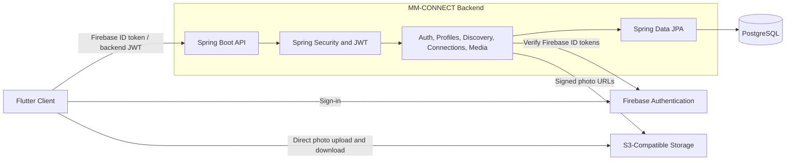

# MM-CONNECT API

**The backend for MM-CONNECT (Parinay), a matrimonial application built for Flutter.**

MM-CONNECT supports the journey from account sign-in and profile creation to
profile discovery, connection requests, and contact sharing after acceptance.

> Status: Under active development.

## Key features

- **Firebase authentication:** Google Sign-In and Phone OTP with backend JWTs.
- **Profile onboarding:** personal, family, community, education, career, and
  lifestyle details, together with partner preferences.
- **Profile discovery:** paginated browsing with gender, age, and city filters,
  plus shortlist and pass actions.
- **Onboarding access checks:** preview discovery before onboarding; complete a
  profile to unlock selected-profile details.
- **Photo management:** direct JPEG uploads through signed storage URLs, with a
  maximum of five saved photos per account.
- **Connection requests:** send, accept, decline, or withdraw requests, with
  participant-only contact sharing after acceptance.

## Architecture

The backend is a **modular monolith**, organized by application feature. Firebase
handles the initial sign-in, while Spring Security and backend JWTs authenticate
subsequent API requests. PostgreSQL stores application data; photo files live in
S3-compatible storage.



| Module | Responsibility |
| --- | --- |
| Authentication | Firebase session exchange and JWT authentication |
| Profiles | Onboarding, profile editing, and selected-profile views |
| Discovery | Filtered browsing, shortlists, and pass actions |
| Connections | Request lifecycle and contact reveal |
| Media | Signed upload/view URLs and photo quota enforcement |
| Shared infrastructure | Configuration, validation, error handling, and migrations |

## Technology stack

| Area | Technology |
| --- | --- |
| Backend | Java 17, Spring Boot 4.1.1 |
| Security | Spring Security, Firebase Admin SDK, JWT |
| Database | PostgreSQL, Spring Data JPA / Hibernate |
| Migrations | Flyway |
| Storage | S3-compatible storage; MinIO for local development |
| API documentation | Springdoc OpenAPI / Swagger UI |
| Testing | JUnit, Mockito, MockMvc, Testcontainers |
| Build and local infrastructure | Maven Wrapper, Docker Compose |

## Application flow

**Sign in → Create a profile → Upload photos → Discover profiles → Connect → Share contact details**

Signed-in users can explore discovery previews before completing onboarding.
Profile details remain locked until onboarding is complete, and contact details
become available to connection participants after acceptance.

## Getting started

1. Open the repository as a Maven project with Java 17 and Docker available.
2. Configure Firebase Admin credentials, a private JWT signing secret, and local
   storage settings. Keep credentials outside version control.
3. Run `com.MM_CONNECT.api.ApiApplication` from IntelliJ, or use the Maven Wrapper:

   ```bash
   ./mvnw spring-boot:run
   ```

   On Windows: `.\mvnw.cmd spring-boot:run`.

The local setup uses Docker Compose for PostgreSQL and MinIO. Flyway applies
schema migrations at startup. Create the configured storage bucket before
uploading photos.

- **API:** `http://localhost:8080`
- **Swagger UI:** `http://localhost:8080/swagger-ui/index.html`
- **Health:** `http://localhost:8080/actuator/health`

## Development status

The core onboarding, discovery, photo upload, and connection flows are
implemented. Saved partner preferences are not yet used for discovery matching.
Photo visibility checks are implemented for selected-profile details; discovery
photos and the standalone media-view endpoint still need privacy improvements.

Chat, admin moderation, refresh/logout, and photo/account deletion are not yet
implemented. The current configuration is intended for local development and
requires deployment-specific security settings before production use.
